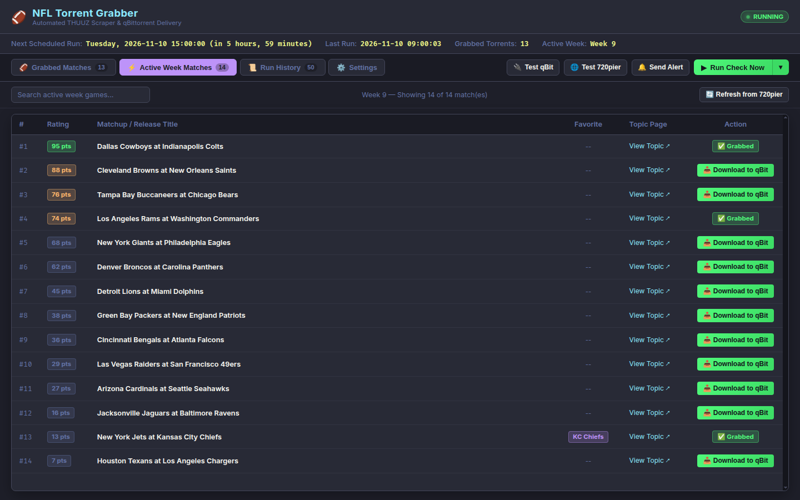
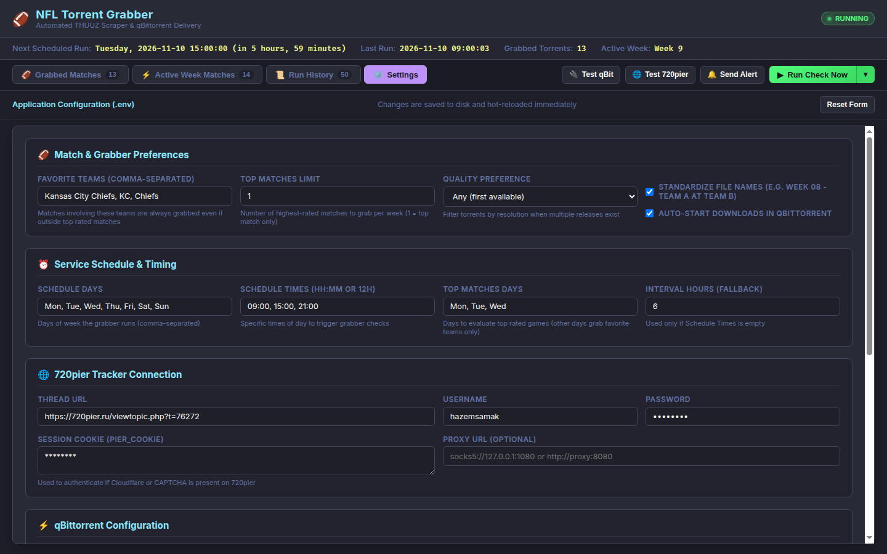
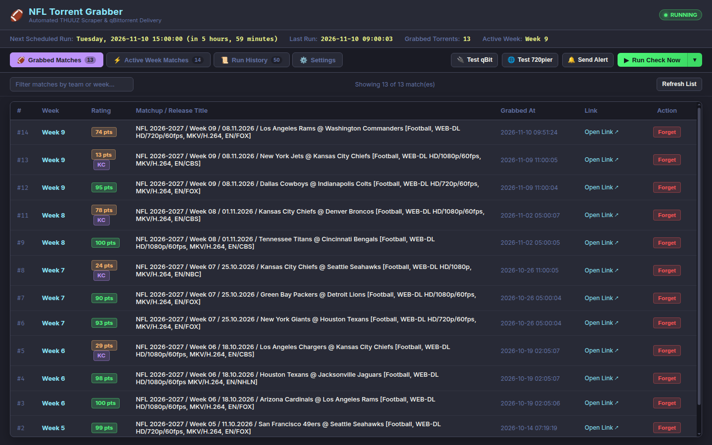
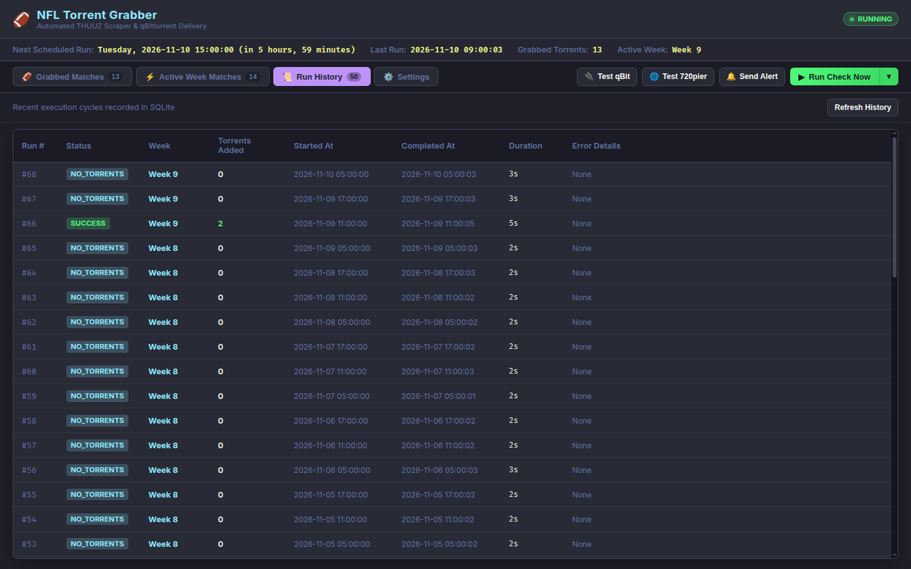

# NFL 720pier THUUZ Torrent Grabber & qBittorrent Forwarder

[](https://www.python.org/)
[](https://www.docker.com/)
[](https://www.qbittorrent.org/)
[](#local-development--testing)
[](LICENSE)

An automated, containerized Python service and interactive web dashboard that monitors the NFL THUUZ Game Rating thread on **720pier.ru**, extracts top-rated games of the latest week, downloads the `.torrent` files using authenticated sessions, and immediately pushes them to an existing **qBittorrent** instance.

Featuring an **Active Week Match Browser** with **1-click selective downloads**, **in-browser Settings Management** with hot-reloading (no container restarts needed!), **configurable top matches limit**, **day/time-based scheduling**, and **SQLite state tracking**.

---

## 📸 Visual Tour & Dashboard Showcase

### ⚡ Active Week Match Browser & Selective Downloads
Inspect every match published for the active week sorted by THUUZ excitement rating. Download any individual match on-demand to qBittorrent with a single click, or check which games have already been grabbed.



---

### ⚙️ Live Web Settings Manager (Hot-Reload)
Manage all grabber preferences, favorite teams, top match quotas, preferred video quality, schedules, and service credentials directly in the browser. Changes persist back to `.env` and immediately hot-reload the running schedulers and API clients in-memory.



---

### 🏈 Grabbed Matches Library
View all downloaded matches across past and current weeks, complete with THUUZ rating scores, timestamps, release titles, direct forum links, and quick-forget actions.



---

### 📜 Run History & Execution Diagnostics
Monitor past automated and manual runs, execution durations, added torrent counts, and error logs with real-time status updates and built-in diagnostic test buttons.



---

## 🌟 Key Features

### ⚡ Active Week Match Browser & Selective 1-Click Downloads
- **Live Forum Scrape**: Automatically extracts all matches for the highest active NFL week directly from the 720pier THUUZ rating thread.
- **THUUZ Excitement Scores**: Displays rating badges (0–100 scale) for each matchup to help you identify the best games to watch.
- **Visual Match Status**: Instantly see which games are already `✅ Grabbed` versus available to download.
- **1-Click Selective Downloads**: Pick and trigger an immediate download for any match directly into qBittorrent on demand, without changing configuration or waiting for scheduled cron runs.
- **Favorite Highlighting**: Automatically tags matchups involving your favorite teams.
- **On-Demand Refresh**: Refresh the active week matchup table anytime with a single click (`🔄 Refresh from 720pier`).

### ⚙️ Web-Based Settings Management & In-Memory Hot Reload
- **Full Control via Web UI**: Configure favorite teams, `TOP_MATCHES_LIMIT`, video quality preference, file renaming, auto-start, schedules, credentials, and notification webhooks directly from the dashboard.
- **No Container Restarts Needed**: Applying changes writes updates back to the `.env` file and **hot-reloads** running schedulers and clients in-memory instantly.
- **Secure Credential Masking**: Forum passwords, browser cookies, API keys, and webhook URLs are masked with `********` to prevent accidental credential leakage.

### 🏈 Automated Top Match & Favorite Team Downloader
- **Configurable Top Matches Quota**: Download the top N rated games per week (configurable via `TOP_MATCHES_LIMIT`, defaulting to top 1 match).
- **Favorite Team Protection**: Always downloads any game involving your configured favorite team(s) (e.g. `Kansas City Chiefs, KC, Chiefs`), regardless of its rating score.
- **Smart Day Filtering**: Filter automatic top-match downloads to specific days (e.g., `TOP_MATCHES_DAYS=Mon,Tue,Wed`) to ensure ratings have stabilized, while still checking for favorite team games daily.

### 📅 Advanced Multi-Slot Scheduling
- **Exact Time Scheduling**: Configure multiple check times per day (e.g., `SCHEDULE_TIMES=09:00,15:00,21:00`).
- **Flexible Day Selection**: Run checks on designated days (`SCHEDULE_DAYS=Mon,Tue,Wed,Thu,Fri,Sat,Sun`).
- **Timezone Aware**: Native container timezone support (`TZ=Asia/Dubai`) ensures scheduled runs trigger precisely when expected.

### 🏷️ Intelligent File Renaming & Media Server Integration
- **Clean Naming Scheme**: Standardizes torrent names and payload filenames to media-server-friendly formats (e.g., `Week 09 - Dallas Cowboys at Indianapolis Colts (2026).mkv`).
- **qBittorrent Organization**: Automatically assigns categories (`NFL`), tags (`720pier,thuuz`), and target download directories (`/nfl`).
- **Asynchronous Registration Resilience**: Retries file renaming if qBittorrent takes a few seconds to ingest the torrent metadata.

### 🔒 Optional HTTP Basic Authentication
- Secure your dashboard with optional HTTP Basic Auth using `WEB_USERNAME` and `WEB_PASSWORD` in `.env`.

### 💾 SQLite State Persistence & Deduplication
- **Embedded SQLite Database (`data/nfl_grabber.db`)**: Stores grabbed torrent records, execution run history, and active week metadata.
- **Duplicate Prevention**: Prevents re-downloading games even across container restarts or image upgrades.
- **Automatic Migration**: Automatically migrates legacy `data/state.json` files to SQLite on startup with automatic backup creation (`data/state.json.bak`).

### 🔌 Diagnostic Suite & Manual Execution Controls
- **1-Click Test Buttons**: Verify qBittorrent connectivity (`🔌 Test qBit`), test 720pier forum session cookies (`🌐 Test 720pier`), and send test webhook notifications (`🔔 Send Alert`).
- **Live vs Dry Run**: Execute an immediate check cycle (`▶ Run Check Now`) or preview matches without sending anything to qBittorrent (`🧪 Dry Run`).

### 🔔 Instant Multi-Channel Alerts
- Push real-time notifications to **Discord** and/or **Telegram** when games are grabbed, distinguishing between automatic scheduled additions and manual 1-click web downloads.

---

## 📁 Project Structure

```text
.
├── main.py                          # Application entrypoint & CLI launcher
├── src/                             # Core application package
│   ├── __init__.py                  # Package initialization
│   ├── config.py                    # Configuration loader, dataclass & .env updater
│   ├── database.py                  # SQLite database manager (data/nfl_grabber.db)
│   ├── main.py                      # Grabber cycle execution & scheduler logic
│   ├── notifier.py                  # Discord & Telegram webhook alerts
│   ├── qbittorrent.py               # qBittorrent Web API client (API Key / Bearer Auth)
│   ├── scraper.py                   # 720pier forum scraper & torrent downloader
│   ├── state.py                     # Legacy state persistence adapter
│   └── web.py                       # Responsive web dashboard UI & REST API server
├── docs/                            # Documentation assets
│   └── screenshots/                 # High-resolution dashboard screenshots
│       ├── dashboard-active-week.png
│       ├── dashboard-grabbed-matches.png
│       ├── dashboard-run-history.png
│       └── dashboard-settings.png
├── scripts/                         # Standalone testing & utility scripts
│   └── test_scrape.py               # Standalone 720pier forum scraping tester
├── tests/                           # Comprehensive automated unit test suite
│   ├── __init__.py
│   └── test_grabber.py              # 40 unit tests covering grabber logic & API
├── data/                            # Persistent volume mount directory (SQLite DB)
│   └── nfl_grabber.db
├── Dockerfile                       # Multi-stage container build specification
├── docker-compose.yml               # Docker Compose service definition
├── docker-compose.override.yml.example # Custom network override template
├── requirements.txt                 # Production Python dependencies
├── .env.example                     # Environment configuration template
└── .env                             # Local environment configuration (git-ignored)
```

---

## 🚀 Quick Start (Docker Compose)

### 1. Clone Repository & Initialize Environment

```bash
git clone https://github.com/hazemsamak/nfl-720pier-scrapper.git
cd nfl-720pier-scrapper
cp .env.example .env
```

### 2. Configure Minimal Settings

Edit `.env` with your preferred editor:

```ini
# 720pier Credentials
PIER_USERNAME=your_forum_username
PIER_PASSWORD=your_forum_password

# OPTIONAL: If 720pier displays Cloudflare or CAPTCHA, paste your browser cookie string:
PIER_COOKIE=

# Favorite team(s) to always download:
FAVORITE_TEAMS=Kansas City Chiefs, KC, Chiefs

# Top rated matches to grab per week (default: 1):
TOP_MATCHES_LIMIT=1

# qBittorrent Connection
QBIT_HOST=http://host.docker.internal:8080
QBIT_API_KEY=qbt_your_api_key_here
QBIT_CATEGORY=NFL
QBIT_TAGS=720pier,thuuz
QBIT_SAVE_PATH=/nfl

# Web Dashboard Port
WEB_PORT=5020
```

> [!TIP]
> You only need to set up minimal credentials in `.env` to start the container. All other settings (schedules, favorite teams, video quality, notifications, etc.) can be configured directly from the **Web Dashboard**!

### 3. Connect to Existing qBittorrent Container

#### Option A: Host Gateway (No file changes needed)
If your qBittorrent container maps its port to your host (e.g. `-p 8087:8087` or `-p 8080:8080`), simply set in `.env`:
```ini
QBIT_HOST=http://host.docker.internal:8087
# or use your server LAN IP:
# QBIT_HOST=http://192.168.1.100:8087
```

#### Option B: Shared Docker Network (Recommended for Docker Setups)
To join an existing qBittorrent Docker network without modifying `docker-compose.yml`:
```bash
cp docker-compose.override.yml.example docker-compose.override.yml
```
Edit `docker-compose.override.yml` and specify your existing network name:
```yaml
services:
  nfl-grabber:
    networks:
      - qbittorrent_network

networks:
  qbittorrent_network:
    external: true
    name: media_network  # Replace with your Docker network name
```
Then set in `.env`:
```ini
QBIT_HOST=http://qbittorrent:8080
```

### 4. Launch Service

```bash
docker compose up -d --build
```

Access the Web Dashboard at:
```text
http://<your-server-ip>:5020
```

View live service logs:
```bash
docker compose logs -f
```

---

## 🌐 Web Dashboard & REST API

The embedded dashboard provides complete operational visibility and control:

| Tab / View | Functionality |
| :--- | :--- |
| **⚡ Active Week Matches** | Live browser for current week games parsed from 720pier, showing THUUZ excitement rating badges, matchup names, favorite team tags, and **1-click selective download buttons**. |
| **⚙️ Settings Management** | Interactive form to configure all grabber preferences and credentials. Saves to `.env` and **hot-reloads** running schedulers in memory. |
| **🏈 Grabbed Matches** | Filterable list of all grabbed torrents with rating scores, timestamps, release titles, and quick links. |
| **📜 Run History** | Historical execution log displaying start/end times, execution duration, status (`SUCCESS`, `NO_TORRENTS`, `ERROR`), and error diagnostics. |
| **Toolbar Actions** | Built-in test buttons (`🔌 Test qBit`, `🌐 Test 720pier`, `🔔 Send Alert`) and split execution trigger (`▶ Run Check Now` / `🧪 Dry Run`). |

### REST API Endpoints

The web service also exposes a lightweight REST API for automation or external integration:

| Method | Endpoint | Description |
| :--- | :--- | :--- |
| `GET` | `/` | Web Dashboard user interface |
| `GET` | `/api/status` | Current service state, next scheduled run, counters, and scheduler status |
| `GET` | `/api/torrents` | List of all grabbed torrents from SQLite database |
| `DELETE` | `/api/torrents?id={id}` | Remove a torrent record from database history |
| `GET` | `/api/matches/active` | Parsed active week matches with grabbed status cross-referencing |
| `POST` | `/api/download` | Trigger 1-click selective download of a specific match into qBittorrent |
| `GET` | `/api/settings` | Retrieve current configuration with sensitive values masked |
| `POST` | `/api/settings` | Save settings to `.env` and hot-reload scheduler in memory |
| `POST` | `/api/run` | Trigger an immediate live check cycle (`dry_run: false`) or dry-run preview (`dry_run: true`) |
| `POST` | `/api/test/qbit` | Test qBittorrent Web API connectivity and authentication |
| `POST` | `/api/test/pier` | Test 720pier forum cookie and thread parsing |
| `POST` | `/api/test/alert` | Dispatch a test notification to configured Discord/Telegram webhooks |

---

## ⚙️ Configuration Reference (`.env`)

| Variable | Default Value | Description |
| :--- | :--- | :--- |
| **720pier Tracker** | | |
| `PIER_THREAD_URL` | `https://720pier.ru/viewtopic.php?t=76272` | URL of the NFL THUUZ Game Rating forum topic on 720pier.ru. |
| `PIER_USERNAME` | *(empty)* | 720pier forum username for automated login. |
| `PIER_PASSWORD` | *(empty)* | 720pier forum password. |
| `PIER_COOKIE` | *(empty)* | Browser session cookie string (e.g. `phpbb3_...`). Recommended to bypass Cloudflare or CAPTCHA challenges. |
| `QUALITY_PREFERENCE` | *(empty)* | Preferred video resolution (`1080p` or `720p`). Leave empty for first available. |
| `FAVORITE_TEAMS` | `Kansas City Chiefs, KC, Chiefs` | Comma-separated list of favorite team keywords to always download. |
| `PROXY_URL` | *(empty)* | Optional HTTP/SOCKS5 proxy (e.g., `socks5://127.0.0.1:1080` or `http://proxy:8080`). |
| **qBittorrent** | | |
| `QBIT_HOST` | `http://qbittorrent:8080` | URL of the qBittorrent WebUI instance. |
| `QBIT_API_KEY` | *(empty)* | qBittorrent WebUI API Key (v5.2.0+, recommended). Generated under WebUI Preferences. |
| `QBIT_USERNAME` | `admin` | Fallback WebUI username if API key is not used. |
| `QBIT_PASSWORD` | `adminadmin` | Fallback WebUI password. |
| `QBIT_CATEGORY` | `NFL` | Category assigned to downloaded torrents in qBittorrent. |
| `QBIT_TAGS` | `720pier,thuuz` | Comma-separated tags assigned to torrents. |
| `QBIT_SAVE_PATH` | `/nfl` | Custom save directory on the qBittorrent server. |
| `QBIT_AUTO_START` | `true` | Automatically resume/start downloads upon adding. |
| `RENAME_TORRENT_FILES` | `true` | Automatically rename torrent and files to clean format (e.g. `Week 08 - Team A at Team B`). |
| **Service & Scheduling** | | |
| `SCHEDULE_DAYS` | `Mon,Tue,Wed,Thu,Fri,Sat,Sun` | Days of the week to execute scheduled checks. |
| `SCHEDULE_TIMES` | `09:00,15:00,21:00` | Specific times of day to run checks (comma-separated HH:MM or 12h: `9 AM, 3 PM`). |
| `TOP_MATCHES_DAYS` | `Mon,Tue,Wed` | Days of the week to evaluate top-rated matches (favorite teams are checked daily). |
| `TOP_MATCHES_LIMIT` | `1` | Number of top rated games to grab per week (1 = top match only, 2 = top 2 matches). |
| `CHECK_INTERVAL_HOURS` | `6` | Fallback interval in hours if `SCHEDULE_TIMES` is empty. |
| `RUN_ON_STARTUP` | `false` | Execute an immediate grabber cycle on container start. |
| `TZ` | `Asia/Dubai` | Container timezone for scheduler execution. |
| **Web Dashboard** | | |
| `WEB_PORT` | `5020` | Port for the embedded web dashboard and REST API. |
| `WEB_ENABLED` | `true` | Enable or disable the embedded web server. |
| `WEB_USERNAME` | *(empty)* | Optional username for HTTP Basic Authentication. |
| `WEB_PASSWORD` | *(empty)* | Optional password for HTTP Basic Authentication. |
| **Notifications** | | |
| `DISCORD_WEBHOOK_URL` | *(empty)* | Discord webhook URL for grab notifications and error alerts. |
| `TELEGRAM_BOT_TOKEN` | *(empty)* | Telegram bot API token for alerts. |
| `TELEGRAM_CHAT_ID` | *(empty)* | Telegram target chat ID for alerts. |
| **Persistence** | | |
| `DB_PATH` | `data/nfl_grabber.db` | SQLite database path for persistent torrent history and run logs. |
| `STATE_FILE_PATH` | `data/state.json` | Path to legacy state file (auto-migrated to SQLite if present). |

---

## 🛠️ Local Development & Testing

### 1. Run Unit Tests

The test suite covers configuration parsing, database operations, forum scraping, qBittorrent API interactions, web server endpoints, and time normalization:

```bash
# Run tests inside Docker container:
docker run --rm -v $(pwd):/app -w /app nfl-torrent-grabber-nfl-grabber python -m unittest discover tests

# Or run tests using local virtual environment:
source venv/bin/activate
python -m unittest discover tests
```

### 2. Standalone Scraping Test

Test forum thread parsing and preview what games would be extracted without downloading:

```bash
python scripts/test_scrape.py
```

### 3. One-Shot Execution

Run a single grabber cycle and exit immediately:

```bash
python main.py --once
```

### 4. Scheduler Execution

Run the service with the background scheduler and web dashboard enabled:

```bash
python main.py
```

---

## ❓ Troubleshooting & FAQ

### 1. 720pier displays CAPTCHA or Cloudflare 403 Forbidden
720pier.ru frequently enables Cloudflare protection or CAPTCHA challenges during high-traffic game days:
1. Open [720pier.ru](https://720pier.ru) in your browser and log into your account.
2. Open Developer Tools (`F12`), go to the **Network** tab, and refresh the page.
3. Click on the first request (`viewtopic.php` or `index.php`) and copy the full value of the `Cookie` request header (containing `phpbb3_...`).
4. Paste the cookie string into the **Web Dashboard Settings** or in `.env` under `PIER_COOKIE=`.
5. Click **Test 720pier** to verify connectivity!

### 2. qBittorrent Authentication Fails
- For qBittorrent **v5.2.0+**: Open WebUI Preferences -> **Web UI** -> **API Key**, generate an API key, and set `QBIT_API_KEY=qbt_...` in `.env` or via the Settings tab.
- For earlier versions: Ensure `QBIT_USERNAME` and `QBIT_PASSWORD` match your WebUI login, and that your server IP is whitelisted under *Bypass authentication for clients on localhost / LAN*.

### 3. Torrent Renaming Delays
Some releases have asynchronous metadata indexing inside qBittorrent. The grabber automatically retries file renaming operations after a short delay to ensure files are renamed accurately without throwing errors.

---

## 📄 License

This project is licensed under the MIT License — see the [LICENSE](LICENSE) file for details.
